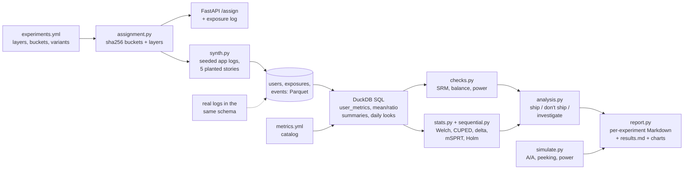

# Experimentation Platform for a Learning App


A small A/B testing platform for a language-learning app. It answers one business question:
*"Did the new practice reminder really increase lesson completion, and can we trust the
result?"* Users are assigned by hashing, metrics are built in SQL on DuckDB, every experiment
goes through checks (sample ratio, pre-period balance, power) before anyone looks at the
effect, and the analysis uses Welch t-tests, CUPED, the delta method and an always-valid
sequential test. Each experiment gets an automatic report with a decision: ship, don't ship,
or investigate. All data is **synthetic**: five experiments, each with a story planted on
purpose, so every decision can be checked against a known truth.

**What this project shows**

- Deterministic assignment: sha256 of salt + user id, traffic allocation by buckets, and layers
  for mutual exclusion. Tested for stability, uniformity, exclusion and independence.
- A metrics pipeline in SQL (`src/xp/sql/*.sql`): exposure-filtered per-user metrics, ratio
  metrics with delta-method variance, guardrails, all driven by a YAML metric catalog.
- Trust checks first: SRM chi-square (it catches a planted Android bug and points at the
  platform), pre-period balance, minimum detectable effect.
- Statistics that are proven by simulation, with confidence intervals: A/A false-positive rate,
  CUPED unbiasedness and variance reduction, the false wins created by daily peeking, and a
  mixture SPRT that keeps false positives under 5% while you watch every day.
- Product judgement in code: a new onboarding that lifts lessons but raises crashes is not
  shipped; secondary metrics are Holm-corrected and do not decide.


## Problem

A learning app ships many small changes: reminders, badges, onboarding flows, home screens.
Each A/B test produces a number, and the number is easy to over-trust:

- **Broken randomisation** (a client bug, a logging gap) makes the arms different before the
  change. The effect estimate is then meaningless, however small the p-value.
- **Noise.** Weekly lessons vary a lot between learners, so a real +3% lift needs tens of
  thousands of users, or a smarter estimator.
- **Peeking.** People look at the dashboard every day and stop when it turns green. With a
  plain t-test that turns a 5% false-positive rate into almost 30%.
- **Trade-offs.** A change can win on the main metric and still hurt users somewhere else.

This repo builds the pieces that handle each of these, and tests them on five planted stories.

## Architecture



Step-by-step code walkthrough: **[docs/how-it-works.md](docs/how-it-works.md)**.
Why each choice was made: **[docs/decisions.md](docs/decisions.md)**.

## Quick start

```bash
python -m venv .venv && source .venv/bin/activate
make install                    # pip install -e ".[dev]"
make check                      # ruff, mypy, pytest with the coverage gate
xp generate                     # seeded synthetic logs in data/ (about 2 million events)
xp analyze practice_reminder    # checks + statistics + reports/practice_reminder.md
xp report                       # all five experiments, simulations, docs/results.md (~30 s)
xp assign u000123               # this user's variant in every experiment
xp serve                        # POST /assign on http://127.0.0.1:8000/docs
```

```bash
curl -X POST localhost:8000/assign -H 'content-type: application/json' \
  -d '{"user_id": "u000123", "exposed": ["practice_reminder"]}'
```

The response lists the user's variant in every experiment they fall into, and which exposures
were logged (only experiments the user actually reached, and only if assigned).

**Real data.** There is no public dataset with this schema, so the repo ships a generator.
To analyse your own app, export three tables as Parquet or CSV into a folder: `users(user_id,
platform)`, `exposures(experiment, user_id, variant, exposed_at)`, `events(user_id,
event_time, event_name)` with `lesson_start`, `lesson_complete`, `notif_unsubscribe`,
`app_crash`. Then `xp analyze <experiment> --data <folder>`. `pipeline.connect` checks the
columns and fails with the table name if one is missing.

## Results (synthetic data)

From `xp report` ([docs/results.md](docs/results.md)): 65,000 users, 222,348 exposure rows
(133,342 repeat visits removed by the SQL), 1,990,591 events.

| Experiment | Planted truth | Primary effect (95% CI) | Decision |
| --- | --- | --- | --- |
| [practice_reminder](docs/experiments/practice_reminder.md) | +3% lessons | +3.8% (+2.1% to +5.5%), CUPED | **ship** |
| [aa_check](docs/experiments/aa_check.md) | nothing (A/A) | -0.6% (-4.4% to +3.1%), CUPED | don't ship (healthy) |
| [streak_badge](docs/experiments/streak_badge.md) | Android client bug | SRM p = 3.1e-09; Android 42.4% in treatment | **investigate** |
| [home_redesign](docs/experiments/home_redesign.md) | nothing, watched daily | daily t-test "won" on day 22 (p = 0.041); mSPRT p = 0.42 | don't ship |
| [new_onboarding](docs/experiments/new_onboarding.md) | +5% lessons, crashes x1.5 | +5.6% (+3.2% to +8.0%), but crash rate +60.3% | **don't ship** |

The answer to the business question: yes, the reminder increased weekly lessons completed,
by +3.8% (95% CI +2.1% to +5.5%), and the result can be trusted: the split is 50/50 (SRM
p = 0.696), the arms were balanced before the test, guardrails are flat, and the CI contains
the planted +3%.

Simulations (same user model, Wilson 95% intervals):

| Claim | Result |
| --- | --- |
| A/A false-positive rate, Welch t-test (4,000 tests) | 4.5% (3.9% to 5.2%) |
| A/A false-positive rate, CUPED | 4.7% (4.1% to 5.4%) |
| CUPED CI width vs raw | 18.5% narrower (variance -33.6%) |
| CUPED mean estimate, true difference 0.0900 | 0.0897 (raw 0.0887), MC s.e. 0.0016 |
| Daily peeking for 28 days, plain t-test | 28.7% (27.3% to 30.1%) false positives |
| Daily peeking for 28 days, mSPRT | 1.1% (0.9% to 1.5%) false positives |
| Power for +3% at 16,000 users per arm | 79.5% raw, 94.2% with CUPED |


**How to read this honestly**

- Every effect was planted, and the user model was written by me. The simulations show that
  the code finds what was planted and that the statistics keep their promises *in this
  world*. Real learners will have heavier tails, novelty effects and weekly seasonality.
- The CUPED variance reduction (about 34%) comes from a correlation of about 0.58 between
  pre-period and in-experiment lessons, which I chose. Real apps often see 20% to 50%.
- The synthetic seed (60) was picked from a scan so that home_redesign shows the peeking trap
  (a false daily win while the final test is not significant). Under no effect that happens
  in about 29% of experiments, as the simulation shows, so it is common, not cherry-picked
  luck in the method. The other four stories hold for most seeds.
- mSPRT's false-positive rate (1.1%) is well below 5%: it is conservative, which costs power.
  If you only ever look once at the end, a fixed-horizon test is more powerful.

## Design decisions (summary)

- **Hash, don't store:** sha256(salt:user) gives the same variant everywhere with no lookup;
  two hashes (layer bucket, variant) keep traffic allocation and the split independent.
- **Analyse exposed users only, from first exposure;** fixed per-user windows, so early and
  late users count the same.
- **Metric logic in SQL,** driven by a YAML catalog with validated identifiers.
- **Checks before results:** SRM at p < 0.001 stops the analysis at "investigate".
- **Welch, not Student;** CUPED with theta pooled over both arms; delta method for ratios.
- **mSPRT instead of O'Brien-Fleming** for monitored tests: look whenever you want.
- **Guardrail fails only if significantly worse AND above its threshold;** secondary metrics
  are Holm-corrected and never decide alone.

Full reasoning and costs: [docs/decisions.md](docs/decisions.md).

## Project layout

```
src/xp/
  experiments.yml  layers, buckets, variants, metrics per experiment
  metrics.yml      metric catalog: type, column or numerator/denominator, direction, threshold
  config.py        typed, validated views of the two YAML files
  assignment.py    sha256 buckets, layers, variant choice, exposure logger
  synth.py         seeded synthetic users, exposures and events with planted stories
  sql/             user_metrics, mean_metrics, ratio_metric, assignment_counts, daily_looks
  pipeline.py      DuckDB connection, schema check, runs the SQL
  checks.py        SRM (overall and per platform), pre-period balance, power/MDE
  stats.py         Welch, CUPED, delta method, MDE, Holm, Wilson
  sequential.py    mixture SPRT: always-valid p-values and confidence sequences
  analysis.py      one experiment end to end, and the decision rules
  simulate.py      vectorised Monte Carlo: A/A, peeking, power curve
  report.py        per-experiment Markdown + chart, docs/results.md + charts
  api.py           optional FastAPI /assign
  cli.py           xp generate | analyze | report | assign | serve
docs/              how-it-works, decisions, results, experiments/, img/
tests/             43 tests, 97% coverage
```

## Testing and quality

- **43 tests** (about 15 seconds): hash values pinned so users never switch variants,
  bucket uniformity (chi-square), mutual exclusion in a layer and independence across layers,
  catalog validation (overlapping buckets, unsafe SQL identifiers), every per-user SQL metric on
  a hand-made dataset (duplicate exposures, events before the pre-period and after the window,
  users with no events, users whose window has not ended), delta-method variance against a
  bootstrap, Welch against scipy, CUPED recovering rho squared and staying unbiased,
  confidence-sequence edges equal to the mSPRT boundary, A/A false-positive rates, peeking
  inflation, SRM detection on the buggy experiment, the guardrail-violation decision, report
  content, CLI and API.
- The tests run on the same seeded logs as `docs/results.md` and check that all five published
  decisions reproduce.
- **CI** (GitHub Actions): ruff lint and format, mypy, pytest with an 80% coverage gate, and
  a CLI smoke run on a small generated dataset. `pre-commit install` runs the same checks.

## What I'd do next

- Run it on real HaiEduTech logs, and compare the CUPED variance reduction with the synthetic
  34%.
- Add novelty-effect checks (effect by days since exposure) and weekly seasonality to the
  generator.
- Cluster-robust variance when the unit of analysis differs from the unit of randomisation
  (for example classes of learners).
- A group-sequential (O'Brien-Fleming) option for teams that commit to a look schedule, and
  a power comparison with mSPRT.
- Store experiment results in a table and build a small dashboard of all running tests.

Data: synthetic, generated by `xp.synth` (seeded). No real users or companies are involved.
Licence of this code: MIT.
