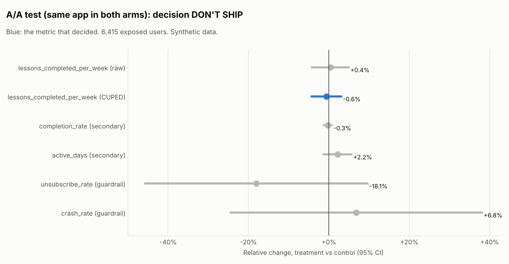

# A/A test (same app in both arms) (`aa_check`)

Data: **Synthetic data** (seeded generator, story planted on purpose). Generated by `xp analyze aa_check`.

## Decision: **DON'T SHIP**

- A/A test: no difference expected and none found. Assignment, logging and statistics look healthy (nothing to ship).

Hypothesis: No difference. Checks that assignment, logging and statistics are healthy.

Design: layer `home`, buckets 0-199 of 1000, split control 50% / treatment 50%, users enter over 7 days and each is followed for 14 days after first exposure. 6,415 exposed users. Analysis: fixed.

## Checks (before looking at results)

| Check | Result | Status |
| --- | --- | --- |
| Sample ratio (SRM) | control 3,202, treatment 3,213; chi-square 0.02, p = 0.891 (flag if p < 0.001) | pass |
| Pre-period balance | pre-period lessons: p = 0.447; platform mix: p = 0.428 | pass |
| Power | MDE 6.5% (5.4% with CUPED) at 80% power vs planned 8%; planned effect needs 2,124 users per arm without CUPED | pass |

Users per platform (SRM by platform):

| Platform | control | treatment | Share in treatment | p |
| --- | --- | --- | --- | --- |
| android | 1,430 | 1,440 | 50.2% | 0.852 |
| ios | 1,291 | 1,257 | 49.3% | 0.501 |
| web | 481 | 516 | 51.8% | 0.268 |

## Metrics

| Metric | Role | Method | Control | Treatment | Relative change (95% CI) | p | Holm p | Status |
| --- | --- | --- | --- | --- | --- | --- | --- | --- |
| lessons_completed_per_week | primary (raw) | Welch t-test | 2.9897 | 3.0005 | +0.4% (-4.2% to +4.9%) | 0.877 | - | see CUPED |
| lessons_completed_per_week | primary | CUPED | 3.0047 | 2.9855 | -0.6% (-4.4% to +3.1%) | 0.738 | - | flat |
| completion_rate | secondary | delta method | 0.8003 | 0.7982 | -0.3% (-1.3% to +0.7%) | 0.602 | 0.602 | flat |
| active_days | secondary | Welch t-test | 4.3901 | 4.4849 | +2.2% (-1.3% to +5.7%) | 0.222 | 0.445 | flat |
| unsubscribe_rate | guardrail | Welch t-test | 0.0228 | 0.0187 | -18.1% (-45.8% to +9.6%) | 0.247 | - | pass |
| crash_rate | guardrail | Welch t-test | 0.0262 | 0.0280 | +6.8% (-24.5% to +38.1%) | 0.661 | - | pass |

CUPED: theta = 0.575 on pre-period lessons per week; variance reduced by 32.1%, CI 17.6% narrower than the raw t-test.

Guardrails fail when they are significantly worse AND worse than the catalog threshold (10% relative). Secondary metrics use Holm-adjusted p-values and do not decide on their own.

