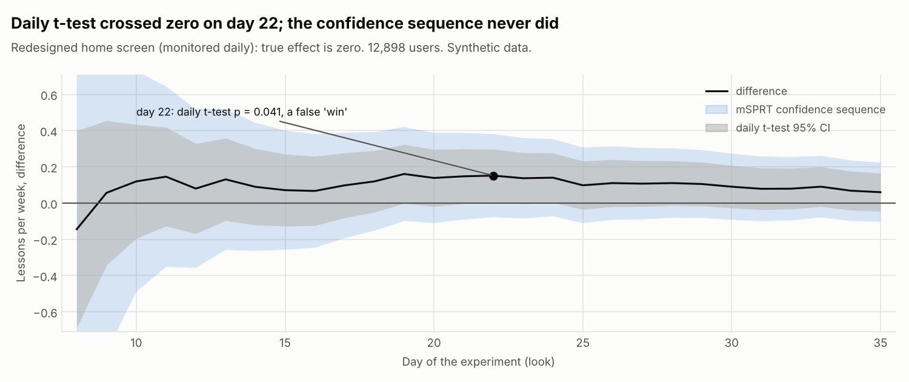

# Redesigned home screen (monitored daily) (`home_redesign`)

Data: **Synthetic data** (seeded generator, story planted on purpose). Generated by `xp analyze home_redesign`.

## Decision: **DON'T SHIP**

- A daily t-test showed a significant win on day 22; a t-test is not valid when you look every day.
- Always-valid (mSPRT) p = 0.42 after 35 days: no reliable effect. The early win is what peeking produces under no effect.

Hypothesis: A cleaner home screen increases lessons completed.

Design: layer `home`, buckets 600-999 of 1000, split control 50% / treatment 50%, users enter over 28 days and each is followed for 7 days after first exposure. 12,898 exposed users. Analysis: sequential.

## Checks (before looking at results)

| Check | Result | Status |
| --- | --- | --- |
| Sample ratio (SRM) | control 6,499, treatment 6,399; chi-square 0.78, p = 0.379 (flag if p < 0.001) | pass |
| Pre-period balance | pre-period lessons: p = 0.814; platform mix: p = 0.010 | pass |
| Power | MDE 5.1% (4.3% with CUPED) at 80% power vs planned 5%; planned effect needs 6,770 users per arm without CUPED | pass |

Users per platform (SRM by platform):

| Platform | control | treatment | Share in treatment | p |
| --- | --- | --- | --- | --- |
| android | 2,844 | 2,971 | 51.1% | 0.096 |
| ios | 2,626 | 2,464 | 48.4% | 0.023 |
| web | 1,029 | 964 | 48.4% | 0.145 |

## Metrics

| Metric | Role | Method | Control | Treatment | Relative change (95% CI) | p | Holm p | Status |
| --- | --- | --- | --- | --- | --- | --- | --- | --- |
| lessons_completed_per_week | primary (raw) | Welch t-test | 2.9401 | 3.0002 | +2.0% (-1.6% to +5.7%) | 0.264 | - | see CUPED |
| lessons_completed_per_week | primary | CUPED | 2.9368 | 3.0036 | +2.3% (-0.8% to +5.3%) | 0.140 | - | flat |
| completion_rate | secondary | delta method | 0.8005 | 0.7969 | -0.5% (-1.4% to +0.5%) | 0.353 | 0.353 | flat |
| active_days | secondary | Welch t-test | 2.1859 | 2.2303 | +2.0% (-0.8% to +4.9%) | 0.154 | 0.309 | flat |
| unsubscribe_rate | guardrail | Welch t-test | 0.0088 | 0.0128 | +46.1% (-3.0% to +95.2%) | 0.026 | - | fail |
| crash_rate | guardrail | Welch t-test | 0.0166 | 0.0130 | -21.9% (-44.1% to +0.2%) | 0.086 | - | pass |

CUPED: theta = 0.588 on pre-period lessons per week; variance reduced by 28.9%, CI 15.7% narrower than the raw t-test.

Guardrails fail when they are significantly worse AND worse than the catalog threshold (10% relative). Secondary metrics use Holm-adjusted p-values and do not decide on their own.

## Daily monitoring

What a dashboard showed each day (users whose 7-day window had ended). The naive t-test p-value is only valid at one pre-planned look; the always-valid mSPRT p-value and confidence sequence stay valid at every look.

| Day | Users | Difference | Naive 95% CI | Naive p | Confidence sequence | Always-valid p |
| --- | --- | --- | --- | --- | --- | --- |
| 8 | 450 | -0.144 | -0.688 to +0.399 | 0.603 | -1.622 to +1.333 | 1.000 |
| 15 | 3,654 | +0.071 | -0.128 to +0.270 | 0.483 | -0.257 to +0.400 | 1.000 |
| 22 | 6,933 | +0.151 | +0.006 to +0.297 | 0.041 | -0.078 to +0.381 | 0.423 |
| 29 | 10,115 | +0.105 | -0.015 to +0.226 | 0.087 | -0.082 to +0.292 | 0.423 |
| 35 | 12,898 | +0.060 | -0.045 to +0.165 | 0.264 | -0.103 to +0.223 | 0.423 |

