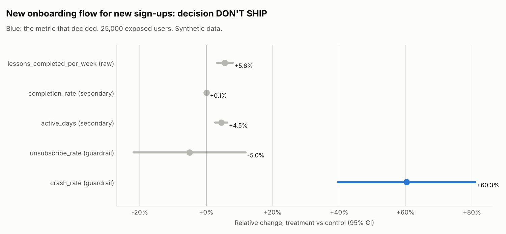

# New onboarding flow for new sign-ups (`new_onboarding`)

Data: **Synthetic data** (seeded generator, story planted on purpose). Generated by `xp analyze new_onboarding`.

## Decision: **DON'T SHIP**

- Guardrail crash_rate is significantly worse: +60.3% (95% CI +39.7% to +80.9%), above the 10% limit.

Hypothesis: A shorter onboarding with a placement quiz increases lessons completed.

Design: layer `onboarding`, buckets 0-999 of 1000, split control 50% / treatment 50%, users enter over 21 days and each is followed for 14 days after first exposure. 25,000 exposed users. Analysis: fixed.

## Checks (before looking at results)

| Check | Result | Status |
| --- | --- | --- |
| Sample ratio (SRM) | control 12,594, treatment 12,406; chi-square 1.41, p = 0.234 (flag if p < 0.001) | pass |
| Pre-period balance | pre-period lessons: no pre-period (new users); platform mix: p = 0.795 | pass |
| Power | MDE 3.3% at 80% power vs planned 5%; planned effect needs 5,550 users per arm without CUPED | pass |

Users per platform (SRM by platform):

| Platform | control | treatment | Share in treatment | p |
| --- | --- | --- | --- | --- |
| android | 5,693 | 5,565 | 49.4% | 0.228 |
| ios | 5,004 | 4,940 | 49.7% | 0.521 |
| web | 1,897 | 1,901 | 50.1% | 0.948 |

## Metrics

| Metric | Role | Method | Control | Treatment | Relative change (95% CI) | p | Holm p | Status |
| --- | --- | --- | --- | --- | --- | --- | --- | --- |
| lessons_completed_per_week | primary (raw) | Welch t-test | 2.9859 | 3.1531 | +5.6% (+3.2% to +8.0%) | 2.5e-06 | - | win |
| completion_rate | secondary | delta method | 0.7978 | 0.7988 | +0.1% (-0.4% to +0.6%) | 0.643 | 0.643 | flat |
| active_days | secondary | Welch t-test | 4.4154 | 4.6159 | +4.5% (+2.7% to +6.3%) | 4.2e-07 | 8.4e-07 | win |
| unsubscribe_rate | guardrail | Welch t-test | 0.0198 | 0.0188 | -5.0% (-21.8% to +11.8%) | 0.569 | - | pass |
| crash_rate | guardrail | Welch t-test | 0.0291 | 0.0466 | +60.3% (+39.7% to +80.9%) | 3.8e-13 | - | fail |

Guardrails fail when they are significantly worse AND worse than the catalog threshold (10% relative). Secondary metrics use Holm-adjusted p-values and do not decide on their own.

