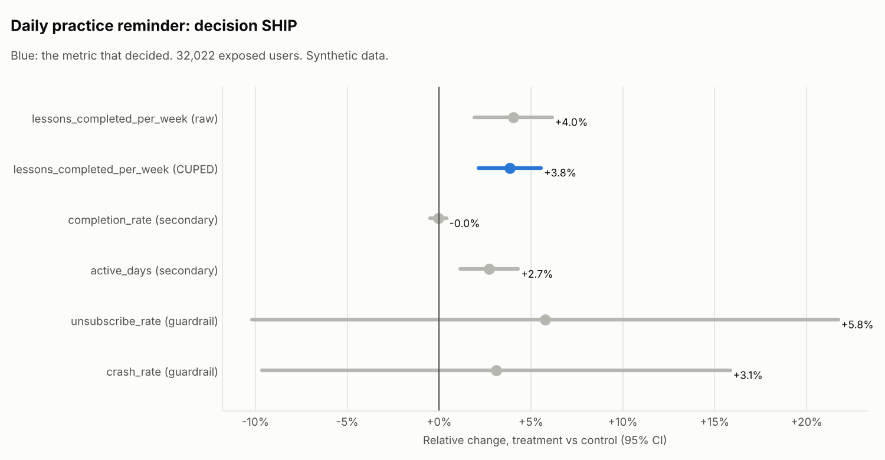

# Daily practice reminder (`practice_reminder`)

Data: **Synthetic data** (seeded generator, story planted on purpose). Generated by `xp analyze practice_reminder`.

## Decision: **SHIP**

- Primary metric lessons_completed_per_week: +3.85% (95% CI +2.14% to +5.55%, CUPED).

Hypothesis: A push reminder at the learner's usual study time increases lessons completed.

Design: layer `notifications`, buckets 0-999 of 1000, split control 50% / treatment 50%, users enter over 7 days and each is followed for 14 days after first exposure. 32,022 exposed users. Analysis: fixed.

## Checks (before looking at results)

| Check | Result | Status |
| --- | --- | --- |
| Sample ratio (SRM) | control 15,976, treatment 16,046; chi-square 0.15, p = 0.696 (flag if p < 0.001) | pass |
| Pre-period balance | pre-period lessons: p = 0.764; platform mix: p = 0.445 | pass |
| Power | MDE 3.0% (2.4% with CUPED) at 80% power vs planned 3%; planned effect needs 15,577 users per arm without CUPED | pass |

Users per platform (SRM by platform):

| Platform | control | treatment | Share in treatment | p |
| --- | --- | --- | --- | --- |
| android | 7,213 | 7,133 | 49.7% | 0.504 |
| ios | 6,306 | 6,428 | 50.5% | 0.280 |
| web | 2,457 | 2,485 | 50.3% | 0.690 |

## Metrics

| Metric | Role | Method | Control | Treatment | Relative change (95% CI) | p | Holm p | Status |
| --- | --- | --- | --- | --- | --- | --- | --- | --- |
| lessons_completed_per_week | primary (raw) | Welch t-test | 2.9673 | 3.0870 | +4.0% (+1.9% to +6.1%) | 1.3e-04 | - | see CUPED |
| lessons_completed_per_week | primary | CUPED | 2.9700 | 3.0842 | +3.8% (+2.1% to +5.5%) | 6.6e-06 | - | win |
| completion_rate | secondary | delta method | 0.8002 | 0.7998 | -0.0% (-0.5% to +0.4%) | 0.831 | 0.831 | flat |
| active_days | secondary | Welch t-test | 4.3982 | 4.5185 | +2.7% (+1.2% to +4.3%) | 5.7e-04 | 0.001 | win |
| unsubscribe_rate | guardrail | Welch t-test | 0.0201 | 0.0213 | +5.8% (-10.2% to +21.7%) | 0.466 | - | pass |
| crash_rate | guardrail | Welch t-test | 0.0300 | 0.0309 | +3.1% (-9.6% to +15.8%) | 0.629 | - | pass |

CUPED: theta = 0.596 on pre-period lessons per week; variance reduced by 34.6%, CI 19.1% narrower than the raw t-test.

Guardrails fail when they are significantly worse AND worse than the catalog threshold (10% relative). Secondary metrics use Holm-adjusted p-values and do not decide on their own.

