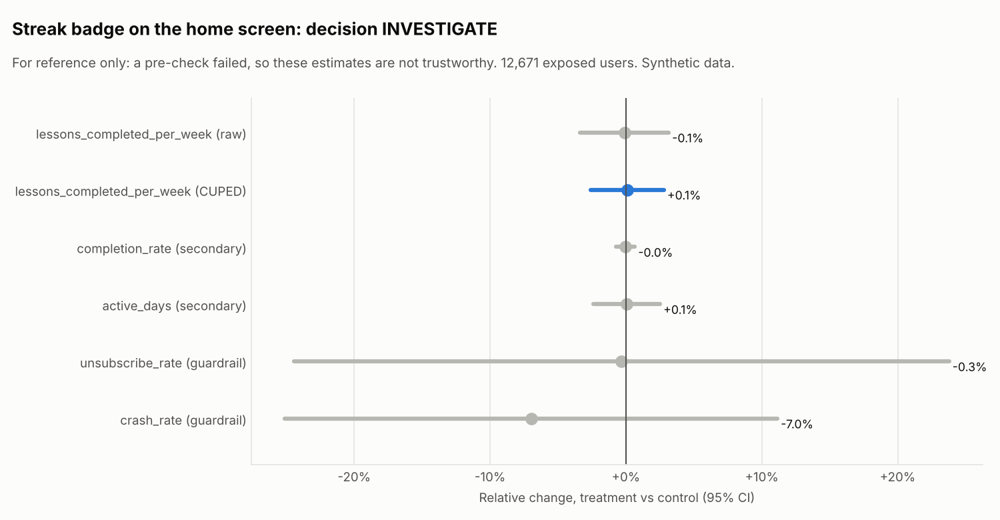

# Streak badge on the home screen (`streak_badge`)

Data: **Synthetic data** (seeded generator, story planted on purpose). Generated by `xp analyze streak_badge`.

## Decision: **INVESTIGATE**

- Sample ratio mismatch: p = 3.1e-09 (threshold 0.001). Worst platform: android with 42.4% of users in treatment instead of 50%. The arms are not comparable; fix assignment or logging and rerun.
- Pre-period balance check failed: the arms differed before the change.

Hypothesis: Showing the learner's streak increases lessons completed.

Design: layer `home`, buckets 200-599 of 1000, split control 50% / treatment 50%, users enter over 7 days and each is followed for 14 days after first exposure. 12,671 exposed users. Analysis: fixed.

## Checks (before looking at results)

| Check | Result | Status |
| --- | --- | --- |
| Sample ratio (SRM) | control 6,669, treatment 6,002; chi-square 35.11, p = 3.1e-09 (flag if p < 0.001) | FAIL |
| Pre-period balance | pre-period lessons: p = 0.828; platform mix: p = 3.9e-23 | FAIL |
| Power | MDE 4.7% (3.8% with CUPED) at 80% power vs planned 5%; planned effect needs 5,482 users per arm without CUPED | pass |

Users per platform (SRM by platform):

| Platform | control | treatment | Share in treatment | p |
| --- | --- | --- | --- | --- |
| android | 3,253 | 2,390 | 42.4% | 1.5e-30 |
| ios | 2,456 | 2,626 | 51.7% | 0.017 |
| web | 960 | 986 | 50.7% | 0.556 |

## Metrics

| Metric | Role | Method | Control | Treatment | Relative change (95% CI) | p | Holm p | Status |
| --- | --- | --- | --- | --- | --- | --- | --- | --- |
| lessons_completed_per_week | primary (raw) | Welch t-test | 3.0172 | 3.0142 | -0.1% (-3.4% to +3.2%) | 0.951 | - | see CUPED |
| lessons_completed_per_week | primary | CUPED | 3.0143 | 3.0174 | +0.1% (-2.6% to +2.8%) | 0.941 | - | flat |
| completion_rate | secondary | delta method | 0.8010 | 0.8007 | -0.0% (-0.7% to +0.7%) | 0.914 | 1.000 | flat |
| active_days | secondary | Welch t-test | 4.4339 | 4.4362 | +0.1% (-2.4% to +2.5%) | 0.968 | 1.000 | flat |
| unsubscribe_rate | guardrail | Welch t-test | 0.0204 | 0.0203 | -0.3% (-24.4% to +23.8%) | 0.979 | - | pass |
| crash_rate | guardrail | Welch t-test | 0.0322 | 0.0300 | -7.0% (-25.1% to +11.2%) | 0.466 | - | pass |

CUPED: theta = 0.579 on pre-period lessons per week; variance reduced by 31.9%, CI 17.5% narrower than the raw t-test.

Guardrails fail when they are significantly worse AND worse than the catalog threshold (10% relative). Secondary metrics use Holm-adjusted p-values and do not decide on their own.

