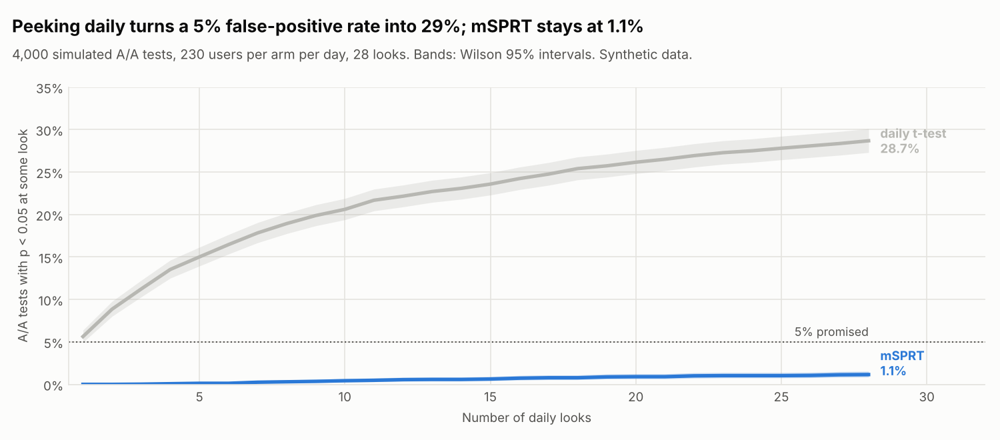
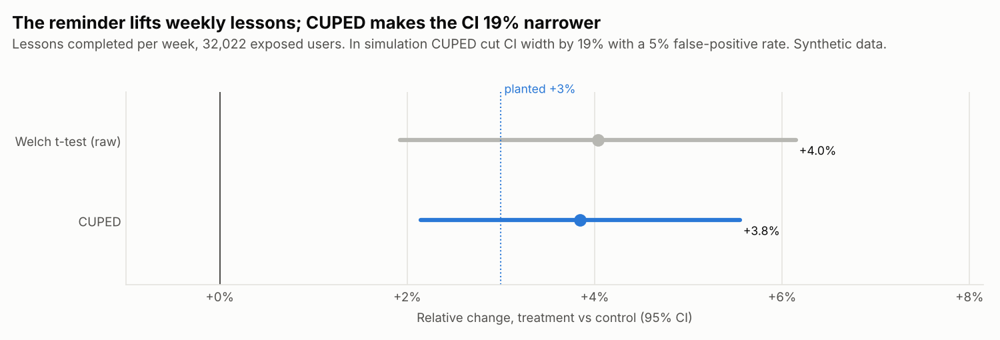

# Results

Data: **Synthetic data** from `xp.synth` (seed 60). Every effect below was planted on purpose so that the platform can be checked against a known truth. All numbers come from `xp report`; rerun it to reproduce them.

Logs: 65,000 users, 222,348 exposure rows (133,342 repeat visits removed by the SQL), 1,990,591 events.

## 1. The five experiments

| Experiment | Planted truth | Users | SRM p | Primary effect (95% CI) | Method | Decision |
| --- | --- | --- | --- | --- | --- | --- |
| [practice_reminder](experiments/practice_reminder.md) | +3% lessons, guardrails flat | 32,022 | 0.696 | +3.8% (+2.1% to +5.5%) | CUPED | **ship** |
| [aa_check](experiments/aa_check.md) | no difference (A/A) | 6,415 | 0.891 | -0.6% (-4.4% to +3.1%) | CUPED | **don't ship** |
| [streak_badge](experiments/streak_badge.md) | Android bug: 15% of treatment shown and logged as control | 12,671 | 3.1e-09 | +0.1% (-2.6% to +2.8%) | CUPED | **investigate** |
| [home_redesign](experiments/home_redesign.md) | no effect; watched daily | 12,898 | 0.379 | +2.3% (-0.8% to +5.3%) | CUPED + mSPRT (always-valid p 0.42) | **don't ship** |
| [new_onboarding](experiments/new_onboarding.md) | +5% lessons, crash rate x1.5 | 25,000 | 0.234 | +5.6% (+3.2% to +8.0%) | Welch t-test | **don't ship** |

- **practice_reminder**: Primary metric lessons_completed_per_week: +3.85% (95% CI +2.14% to +5.55%, CUPED).
- **aa_check**: A/A test: no difference expected and none found. Assignment, logging and statistics look healthy (nothing to ship).
- **streak_badge**: Sample ratio mismatch: p = 3.1e-09 (threshold 0.001). Worst platform: android with 42.4% of users in treatment instead of 50%. The arms are not comparable; fix assignment or logging and rerun. Pre-period balance check failed: the arms differed before the change.
- **home_redesign**: A daily t-test showed a significant win on day 22; a t-test is not valid when you look every day. Always-valid (mSPRT) p = 0.42 after 35 days: no reliable effect. The early win is what peeking produces under no effect.
- **new_onboarding**: Guardrail crash_rate is significantly worse: +60.3% (95% CI +39.7% to +80.9%), above the 10% limit.

Reminder, raw vs CUPED: raw t-test +4.0% (+1.9% to +6.1%), p = 1.3e-04; CUPED +3.8% (+2.1% to +5.5%), p = 6.6e-06. CUPED cut the variance by 34.6% and the CI width by 19.1%. Both intervals contain the planted +3%.

## 2. Simulations: do the statistics keep their promises?

Simulated experiments drawn from the same user model as the logs, 2,000 users per arm, 2-week window. Rates have Wilson 95% intervals.

### False positives with no effect (A/A)

| Method | False-positive rate at alpha = 5% | Mean CI width (lessons/week) |
| --- | --- | --- |
| Welch t-test | 4.5% (3.9% to 5.2%) | 0.345 |
| CUPED | 4.7% (4.1% to 5.4%) | 0.281 |

4,000 simulated A/A tests. CUPED reduced the variance by 33.6% on average and the CI width by 18.5%, with the same false-positive rate.

### CUPED is unbiased (true lift +3%)

| Method | Mean estimated difference | True difference | Power |
| --- | --- | --- | --- |
| Welch t-test | 0.0887 (MC s.e. 0.0020) | 0.0900 | 16.8% (15.2% to 18.4%) |
| CUPED | 0.0897 (MC s.e. 0.0016) | 0.0900 | 22.7% (20.9% to 24.5%) |

2,000 simulated experiments. The spread of the estimate across experiments is 0.0876 raw vs 0.0716 with CUPED.

### Peeking every day

4,000 simulated A/A tests, 230 new users per arm per day, each followed 1 week, looked at every day for 28 days (like home_redesign). A test counts as a false positive if it rejects (either direction) at any look so far.

| Looks so far | Daily t-test: false-positive rate | mSPRT: false-positive rate |
| --- | --- | --- |
| 1 | 5.6% (5.0% to 6.4%) | 0.0% (0.0% to 0.1%) |
| 7 | 17.8% (16.7% to 19.0%) | 0.2% (0.1% to 0.5%) |
| 14 | 23.1% (21.8% to 24.4%) | 0.6% (0.4% to 0.9%) |
| 21 | 26.5% (25.2% to 27.9%) | 0.9% (0.7% to 1.2%) |
| 28 | 28.7% (27.3% to 30.1%) | 1.1% (0.9% to 1.5%) |

A single t-test at the last day only: 5.5% (4.9% to 6.3%).

### Power vs sample size (true lift +3%)

| Users per arm | Welch t-test | CUPED | Analytic (t-test) |
| --- | --- | --- | --- |
| 2,000 | 19.0% (15.5% to 23.1%) | 24.8% (20.8% to 29.2%) | 17.2% |
| 4,000 | 30.2% (26.0% to 34.9%) | 42.5% (37.7% to 47.4%) | 29.7% |
| 8,000 | 55.0% (50.1% to 59.8%) | 70.0% (65.3% to 74.3%) | 52.2% |
| 12,000 | 71.0% (66.4% to 75.2%) | 86.0% (82.3% to 89.1%) | 69.4% |
| 16,000 | 79.5% (75.3% to 83.2%) | 94.2% (91.5% to 96.1%) | 81.3% |

400 simulated experiments per size. The analytic column uses the normal approximation with the simulated variance; the simulated t-test power should match it.

